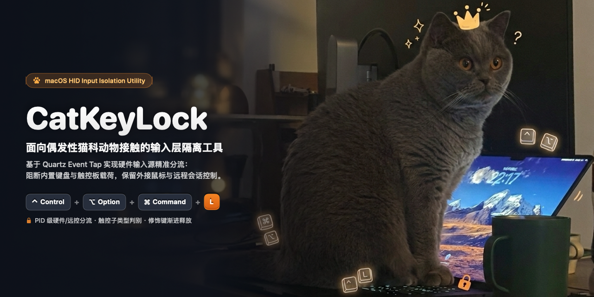
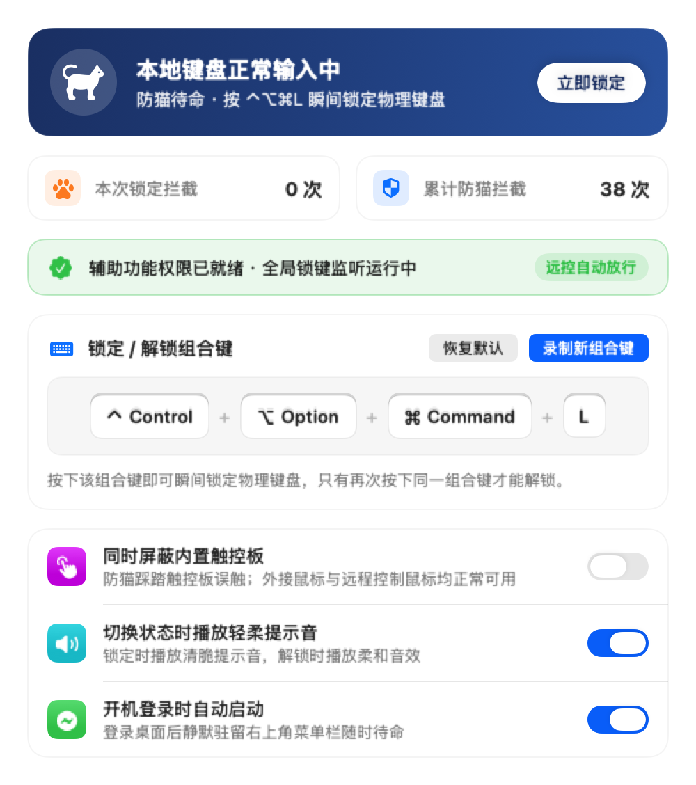
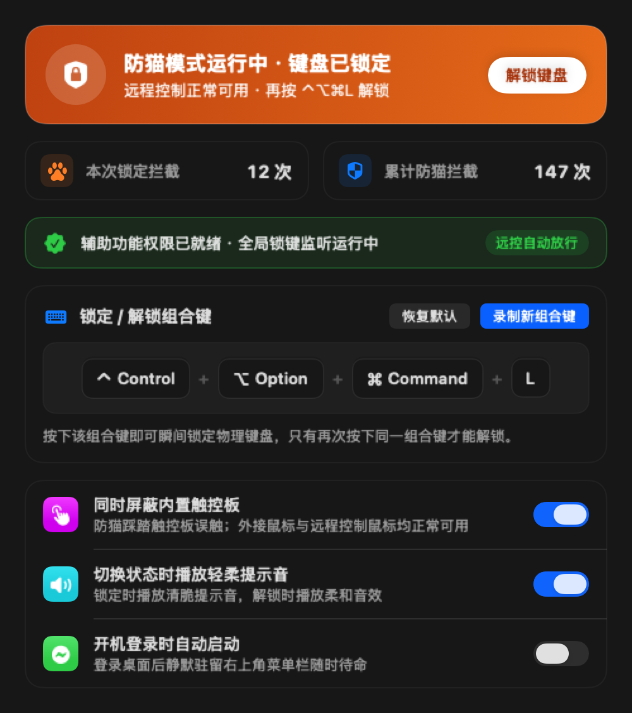
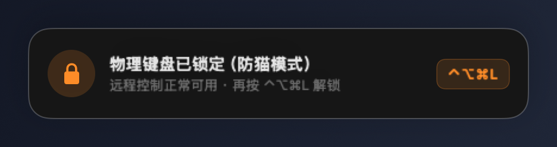

<div align="center">



<br /><br />

# CatKeyLock

**面向偶发性猫科动物（*Felis catus*）物理接触的 macOS 硬件输入层隔离工具**

<p>
  
  
  
  
</p>

</div>

---

## 1. 背景与问题定义（Problem Statement）

在包含家猫（*Felis catus*）的桌面科研与软件开发环境中，便携式工作站（如 MacBook 系列）因键盘区域持续散发余热且处于操作者视觉焦点内，极易成为猫科个体驻留、踩踏与卧姿休息的高频目标表面。质量约为 4–6 kg 的个体接触输入面板时，通常会引发三类非预期干扰：

1. **高熵字符注入**：向当前活动终端、代码编辑器或即时通讯窗口写入无语义随机字符序列（如 `asdfghjkl;'`），并在特定概率下触发回车提交；
2. **控制信号误触发**：随机并发按键诱发前台计算任务中断（`Control + C`）、文档关闭（`⌘W`）或应用程序退出（`⌘Q`）；
3. **跨会话修饰键与指针污染**：当操作者试图在旁侧使用独立外接鼠标，或通过远程桌面协议（ToDesk、UU 远程、macOS 屏幕共享）继续推进任务时，持续受压的物理修饰键（`Shift` / `Command` / `Option`）与内置触控板接触信号会与合法输入叠加，导致人机交互失效。

传统的全局键盘锁定工具通常采用“无差别阻断”策略，在切断物理键盘的同时一并阻断独立外接鼠标与远程桌面输入，难以满足多会话并发场景的需要。**CatKeyLock** 旨在解决这一工程矛盾：通过单一预设组合键（默认 `⌃⌥⌘L`）即时隔离本地受压输入面，同时无损保留独立外接鼠标与远程控制会话的完整操作能力。

---

## 2. 输入源隔离策略矩阵（Input Isolation Matrix）

当系统处于激活隔离态（Active Isolation State，默认触发与解除组合键均为 **`⌃⌥⌘L`**）时，各类 HID 与注入事件源遵循如下路由策略：

| 输入事件源 | 底层特征标识 | 隔离态路由策略 | 工程与观测依据 |
| :--- | :--- | :---: | :--- |
| **内置物理键盘**（字符键 / 功能键 / 修饰键） | `eventSourceUnixProcessID == 0` | **阻断 (Drop)** | 全量拦截来自本地 IOHID 驱动的按键与修饰键状态变更事件，并实时累计单次与历史拦截计数 |
| **系统媒体与硬件控制键**（音量 / 亮度 / 播放） | `NSSystemDefined (type 14, subtype 8)` | **阻断 (Drop)** | 防止非预期生物质量压迫顶部功能区导致扬声器音量突增或屏幕背光归零 |
| **内置多点触控板**（可选独立开关） | `mouseEventSubtype == 3` / 连续滚动相位 / 手势事件 | **阻断 (Drop)** | 屏蔽内置触控表面的指针移动、轻点/按压点击、双指连续滚动及多指手势，消除肢体卧靠引起的误触 |
| **独立外接物理鼠标**（有线 / 蓝牙 / 2.4G） | `mouseEventSubtype == 0` 且无触控滚动相位 | **放行 (Pass)** | 现有观测表明实验对象 *Felis catus* 尚不具备握持与操控独立外接鼠标的运动机能，操作者可正常移动、点击、拖拽与滚动 |
| **远程桌面注入会话**（ToDesk / UU 远程 / 屏幕共享） | `eventSourceUnixProcessID > 0` | **放行 (Pass)** | 用户态远控守护进程通过 `CGEventPost` 注入的键盘与指针事件完整透传，保障异地或局域网接管不受本地物理锁定影响 |
| **预设切换热键序列**（默认 `⌃⌥⌘L`） | 多修饰键精确匹配 + `autorepeat == 0` | **状态翻转 (Toggle)** | 四键并发组合在随机踩踏下的误触发概率极低；仅精确按下同一组合键或通过外接/远控鼠标点击菜单栏控制项可解除隔离 |

---

## 3. 系统界面与运行状态（Interface Overview）

程序采用原生 **SwiftUI** 构建，通过 `LSUIElement` 配置静默驻留 macOS 右上角菜单栏（不占用程序坞空间），支持浅色 / 深色系统外观自适应，并配备基于非激活面板（`NSPanel` `.nonactivatingPanel`）的顶部毛玻璃状态指示器，确保状态切换时不剥夺当前终端或代码编辑器的输入焦点。

<div align="center">
<table>
  <tr>
    <td align="center" width="50%">
      <strong>浅色外观 · 待命监听态</strong><br /><br />
      
    </td>
    <td align="center" width="50%">
      <strong>深色外观 · 硬件隔离激活态</strong><br /><br />
      
    </td>
  </tr>
  <tr>
    <td colspan="2" align="center">
      <strong>非抢占式顶部毛玻璃状态指示器（<code>nonactivatingPanel</code>）</strong><br /><br />
      
    </td>
  </tr>
</table>
</div>

### 交互与辅助特性
- **可视化热键录制与冲突校验**：支持自定义锁定/解锁组合键，内置禁用集合校验，自动拒绝 `⌘Q`、`⌃⌘Q`（系统锁屏）、`⌘W`、`⌘Tab`、`⌘Space` 等系统级或高风险快捷键。
- **状态切换声学反馈**：可按需开启轻柔系统音效（锁定时播放 `"Tink"`，解除时播放 `"Purr"`）。
- **开机登录自启动**：基于 macOS 原生 `SMAppService` 注册登录项，登录桌面后自动进入待命监听状态。

---

## 4. 架构与事件判别机制（Architecture & Event Discrimination）

CatKeyLock 在 macOS Quartz Event Services 的 `kCGHIDEventTap`（`.headInsertEventTap`）节点挂载全局事件过滤器，依据事件元数据执行低延迟分流：

1. **本地硬件与远程会话的进程级分流（`eventSourceUnixProcessID`）**
   - 来自本地物理键盘与内置触控板的硬件中断由内核 IOHID 家族直接分发，其事件字段 `CGEventField.eventSourceUnixProcessID`（字段 41）恒等于 `0`。
   - **ToDesk**、**UU 远程** 及 **macOS 屏幕共享（`ScreensharingAgent`）** 等远程控制客户端在用户态通过 `CGEventPost` 合成事件，CoreGraphics 会自动记录注入进程的 Unix PID（`> 0`）。
   - 过滤器在隔离态下对所有 `sourcePID != 0` 的事件直接放行，实现本地硬件阻断与远控会话透传的严格正交。

2. **内置触控板与外接鼠标的子类型判别（`mouseEventSubtype` & Scroll Phase）**
   - 开启「同时屏蔽内置触控板」后，过滤器依据事件子类型与触控相位识别事件来源：内置触控板的指针与点击事件携带 `mouseEventSubtype == 3`（`NX_SUBTYPE_MOUSE_TOUCH`）；双指滚动具备连续像素与触控相位（`scrollWheelEventIsContinuous != 0` 且存在 `ScrollPhase` 或 `MomentumPhase`）；多指手势与 Force Touch 对应专属系统手势事件号（`18, 19, 20, 29–34, 37`）。
   - 独立外接物理鼠标事件特征为 `mouseEventSubtype == 0`（`NX_SUBTYPE_DEFAULT`）且无触控滚动相位，因此始终完整放行。

3. **修饰键渐进释放状态机与防抖控制（Modifier Release Drain & Debounce）**
   - 当操作者按下 `⌃⌥⌘L` 触发隔离态的瞬态阶段，硬件修饰键尚未立即全部抬起；若当即无差别丢弃所有 `flagsChanged`，会导致窗口服务器认为 `Control`/`Option`/`Command` 处于持久按住状态（修饰键粘滞）。
   - 为此，状态机在进入隔离态时同步记录当时的物理修饰键集合，仅放行单调递减（键位只减不增）的物理 `flagsChanged` 事件直至修饰键位图归零，随后闭锁全部后续物理修饰键变更。同时忽略硬件长按自动连发（`keyboardEventAutorepeat != 0`）并设置 `0.35 s` 状态翻转冷却窗口。

---

## 5. 安装、构建与权限配置（Installation & Build）

### 方式一：安装预编译版本（推荐）

1. 前往仓库右侧 [**Releases**](https://github.com/Jhe1004/CatKeyLock/releases) 下载最新 `CatKeyLock-v1.0.0-macOS-arm64.zip`。
2. 解压并将 `CatKeyLock.app` 移至 `/Applications` 或 `~/Applications`。
3. 由于预编译包采用本地 ad-hoc 签名（未使用 Apple Developer ID 公证），首次启动前若遇到 Gatekeeper 安全提示，可右键点击应用选择「打开」，或在终端执行一次以清除隔离属性：
   ```bash
   xattr -cr /Applications/CatKeyLock.app
   ```

### 方式二：源码编译（需要 Xcode Command Line Tools）

```bash
git clone https://github.com/Jhe1004/CatKeyLock.git
cd CatKeyLock
bash build.sh
open "$HOME/Applications/CatKeyLock.app"
```

> `build.sh` 会自动先执行 `Tests/RunTests.swift` 中的 8 项核心状态机单元测试，全部通过后生成应用图标、编译 `CatKeyLock.app` 并安装至 `~/Applications/`。

### 首次使用权限配置

启动应用后，按界面提示前往 **「系统设置 → 隐私与安全性 → 辅助功能」**，开启 **`CatKeyLock`** 的访问权限开关。授权后**无需重启应用**，后台会在 1 秒内自动检测权限就绪并挂载全局事件监听器。

*(若您自行修改源码并重新执行构建，ad-hoc 签名哈希变化可能导致系统 TCC 缓存仍绑定旧签名记录；此时可点击设置界面中的 **「重置记录」** 按钮，或在终端执行 `tccutil reset Accessibility com.jianhe.CatKeyLock` 后重新开启一次开关。)*

---

## 6. 已知局限性（Known Limitations）

尽管本工具在软件事件分发层实现了高精度隔离，受限于物理定律与硬件架构边界，仍存在以下已知局限性：

1. **几何光学视野遮挡**：`kCGHIDEventTap` 仅能阻断电信号层面的非预期输入，无法消除 *Felis catus* 端坐或卧于键盘上方时对内置显示屏下半部分造成的物理遮挡。建议配合高位外接显示器或远程桌面客户端进行观测。
2. **桌面次生机械交互**：经验观测表明，当键盘按键失去视觉与听觉反馈后，部分受试个体可能将交互目标转移至周边桌面实体（例如拨弄水杯、拍打外接显示器边框或踩踏电源排插开关）。此类宏观力学过程超出软件工程控制范畴。
3. **PMU 硬件级强制断电**：长按 MacBook 右上角物理电源键（Touch ID 键）数秒触发的强制关机由底层电源管理单元（PMU）直接接管，无法在操作系统软件层通过 `CGEventTap` 拦截。

---

## 7. 开源许可（License）

本项目基于 [MIT License](LICENSE) 协议开源。
