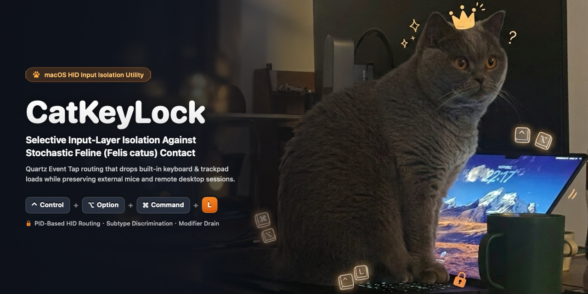
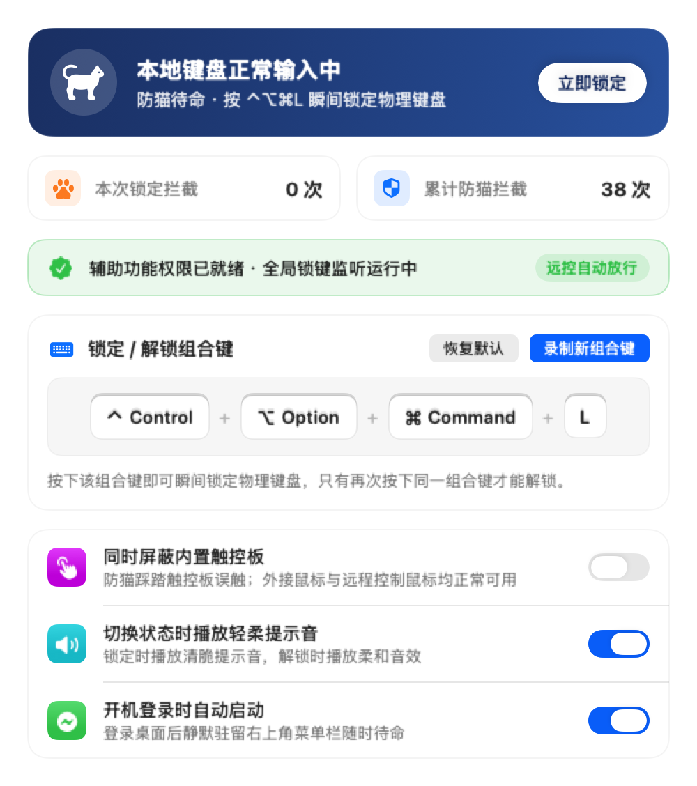
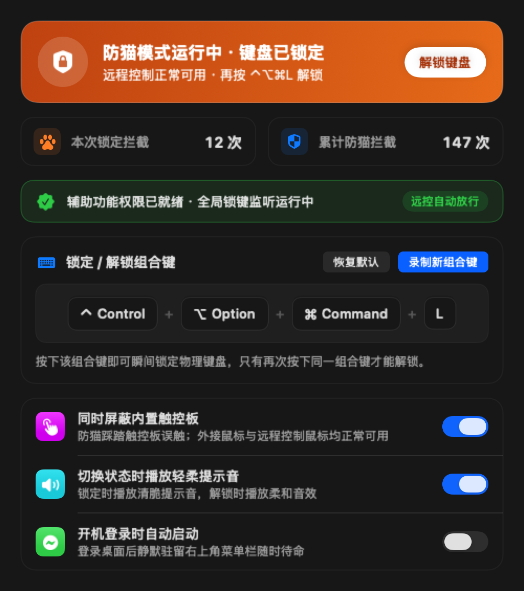
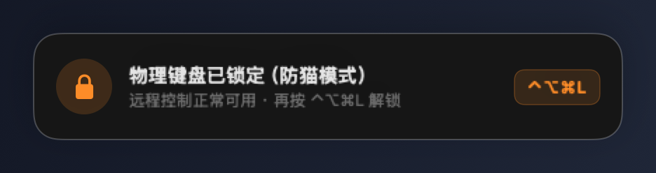

<div align="center">



<br /><br />

# CatKeyLock

**Selective macOS HID Input-Layer Isolation Against Stochastic Feline (*Felis catus*) Contact**

<p>
  
  
  
  
</p>

<p>
  <a href="README.md">简体中文</a> &nbsp;·&nbsp; <strong>English</strong>
</p>

</div>

---

## 1. Problem Statement

In research and software engineering workstations cohabited with domestic cats (*Felis catus*), portable laptops (e.g., MacBook hardware) frequently become high-probability resting targets due to localized thermal dissipation across the keyboard deck and proximity to the operator's line of sight. Physical contact by a 4–6 kg specimen typically introduces three classes of non-deterministic input interference:

1. **High-Entropy Character Injection**: Unintended insertion of arbitrary character sequences (e.g., `asdfghjkl;'`) into active terminals, code editors, or messaging clients, occasionally followed by an unintentional `Return` submission.
2. **Spurious Control Signal Dispatch**: Stochastic multi-key actuation triggering foreground process interruption (`Control + C`), document closure (`⌘W`), or application termination (`⌘Q`).
3. **Cross-Session Modifier & Pointer Contamination**: When the operator attempts to regain control via an independent external mouse or a remote desktop session (ToDesk, UU Remote, macOS Screen Sharing), sustained depression of physical modifier keys (`Shift` / `Command` / `Option`) and built-in trackpad contact continues to mix with legitimate input streams, corrupting remote and pointer interactions.

Conventional keyboard-locking utilities enforce indiscriminate global suppression—severing external mice and remote desktop control alongside the built-in keyboard. **CatKeyLock** resolves this constraint by isolating only the compromised local hardware surfaces via a single deterministic key chord (default: `⌃⌥⌘L`), while preserving external mouse usability and remote desktop sessions without degradation.

---

## 2. Input Isolation Matrix

When the system enters the Active Isolation State (toggled via **`⌃⌥⌘L`** by default), HID and synthetic event streams are routed according to the following policy matrix:

| Input Source | Low-Level Event Signature | Policy Under Isolation | Engineering & Empirical Rationale |
| :--- | :--- | :---: | :--- |
| **Built-in Physical Keyboard** (Alphanumeric / Function / Modifiers) | `eventSourceUnixProcessID == 0` | **Drop** | Suppresses all local IOHID keystroke and modifier state-change events while incrementing per-session and cumulative interception counters |
| **System Media & Hardware Keys** (Volume / Brightness / Playback) | `NSSystemDefined (type 14, subtype 8)` | **Drop** | Prevents stochastic paw contact along the top function row from driving speaker volume to maximum or zeroing display backlight |
| **Built-in Multi-Touch Trackpad** (Optional Toggle) | `mouseEventSubtype == 3` / continuous scroll phase / gesture events | **Drop** | Filters pointer motion, tap/force clicks, two-finger continuous scrolling, and multi-finger gestures originating from the integrated trackpad surface |
| **External Physical Mouse** (Wired / Bluetooth / 2.4 GHz) | `mouseEventSubtype == 0` with non-touch scroll phase | **Pass** | Empirical observation indicates that *Felis catus* specimens lack the prehensile motor dexterity required to grasp and actuate an independent external mouse; normal movement, clicks, drags, and wheel scrolling remain unobstructed |
| **Remote Desktop Sessions** (ToDesk / UU Remote / Screen Sharing) | `eventSourceUnixProcessID > 0` | **Pass** | Events injected in user space via `CGEventPost` by remote control daemons pass through intact, enabling uninterrupted remote keyboard and pointer control |
| **Configured Toggle Chord** (Default `⌃⌥⌘L`) | Exact multi-modifier match + `autorepeat == 0` | **Toggle** | Simultaneous four-key actuation exhibits negligible false-trigger probability under random paw contact; isolation can only be disengaged by repeating the exact chord or clicking the menu bar control via mouse/remote |

---

## 3. Interface Overview

Implemented natively in **SwiftUI** and configured as a menu bar agent (`LSUIElement`, occupying no Dock slot), CatKeyLock adapts to Light and Dark appearances and displays a non-activating translucent HUD (`NSPanel` with `.nonactivatingPanel`) so state transitions never steal focus from an active terminal or editor. *(Note: the current in-app UI copy is localized in Simplified Chinese.)*

<div align="center">
<table>
  <tr>
    <td align="center" width="50%">
      <strong>Light Appearance · Standby Monitoring</strong><br /><br />
      
    </td>
    <td align="center" width="50%">
      <strong>Dark Appearance · Active HID Isolation</strong><br /><br />
      
    </td>
  </tr>
  <tr>
    <td colspan="2" align="center">
      <strong>Non-Activating Translucent HUD Indicator (<code>nonactivatingPanel</code>)</strong><br /><br />
      
    </td>
  </tr>
</table>
</div>

### Operational Safeguards & Ergonomics
- **Interactive Chord Recorder & Conflict Validation**: Supports custom lock/unlock combinations while rejecting system-critical or destructive chords (`⌘Q`, `⌃⌘Q`, `⌘W`, `⌘Tab`, `⌘Space`, etc.).
- **Acoustic State Feedback**: Optional subtle system audio cues (`"Tink"` on lock engagement; `"Purr"` on release).
- **Launch at Login**: Native `SMAppService` integration for silent background initialization upon user login.

---

## 4. Architecture & Event Discrimination

CatKeyLock attaches a global Quartz event filter at `kCGHIDEventTap` (`.headInsertEventTap`) and dispatches incoming events with minimal latency using three discrimination mechanisms:

1. **Process-Level Hardware vs. Remote Routing (`eventSourceUnixProcessID`)**
   - Physical hardware interrupts originating from the built-in keyboard and trackpad are emitted directly by the kernel IOHID family, carrying `CGEventField.eventSourceUnixProcessID` (field `41`) equal to `0`.
   - Remote desktop clients (**ToDesk**, **UU Remote**, **macOS `ScreensharingAgent`**) inject synthetic events from user space via `CGEventPost`, causing CoreGraphics to populate the injecting process's Unix PID (`> 0`).
   - Under active isolation, any event with `sourcePID != 0` is unconditionally passed through, guaranteeing strict orthogonality between local hardware suppression and remote control.

2. **Built-in Trackpad vs. External Mouse Subtype Discrimination (`mouseEventSubtype` & Scroll Phase)**
   - When integrated trackpad isolation is enabled, pointer and click events generated by the built-in trackpad carry `mouseEventSubtype == 3` (`NX_SUBTYPE_MOUSE_TOUCH`); two-finger scrolling exhibits continuous pixel flags and touch phases (`scrollWheelEventIsContinuous != 0` with active `ScrollPhase` or `MomentumPhase`); and multi-finger gestures/Force Touch map to dedicated gesture event types (`18, 19, 20, 29–34, 37`).
   - Independent external physical mice emit `mouseEventSubtype == 0` (`NX_SUBTYPE_DEFAULT`) without touch-scroll phases and are therefore preserved verbatim.

3. **Monotonic Modifier Release Drain & Debounce Control**
   - At the exact instant the user presses `⌃⌥⌘L` to engage isolation, the physical modifier keys remain momentarily depressed. Immediately dropping all `flagsChanged` events would leave the WindowServer in a stuck-modifier state (`Control`/`Option`/`Command` held down).
   - To prevent this, the engine records the active physical modifier bitmap upon lock engagement and passes through strictly monotonically decreasing physical `flagsChanged` transitions until the modifier bitmap reaches zero, at which point all subsequent physical modifier changes are blocked. Hardware key auto-repeat (`keyboardEventAutorepeat != 0`) is ignored, and a `0.35 s` debounce window prevents rapid oscillation.

---

## 5. Installation & Build

### Option A: Prebuilt Binary (Recommended)

1. Download the latest `CatKeyLock-v1.0.0-macOS-arm64.zip` from [**Releases**](https://github.com/Jhe1004/CatKeyLock/releases).
2. Extract the archive and move `CatKeyLock.app` to `/Applications` or `~/Applications`.
3. Because the prebuilt bundle uses an ad-hoc signature (without Apple Developer ID notarization), if Gatekeeper prompts on first launch, right-click the app and choose **Open**, or clear the quarantine attribute once in Terminal:
   ```bash
   xattr -cr /Applications/CatKeyLock.app
   ```

### Option B: Build from Source (Requires Xcode Command Line Tools)

```bash
git clone https://github.com/Jhe1004/CatKeyLock.git
cd CatKeyLock
bash build.sh
open "$HOME/Applications/CatKeyLock.app"
```

> `build.sh` executes the 8 core state-machine unit tests in `Tests/RunTests.swift` prior to icon generation, compilation, and installation into `~/Applications/`.

### Accessibility Permission Setup

Upon launch, follow the in-app prompt to open **System Settings → Privacy & Security → Accessibility** and enable **`CatKeyLock`**. Once granted, the background monitor detects authorization within 1 second and activates the event tap without requiring an app restart.

*(If you modify and rebuild the source locally, the ad-hoc `cdhash` changes; click **Reset Record** in the settings window or run `tccutil reset Accessibility com.jianhe.CatKeyLock` in Terminal and re-toggle the switch once.)*

---

## 6. Known Limitations

While CatKeyLock achieves deterministic isolation at the Quartz event-dispatch layer, the following physical and hardware boundaries remain outside software scope:

1. **Geometric-Optical Line-of-Sight Occlusion**: `kCGHIDEventTap` suppresses electrical input signals only; it cannot eliminate physical occlusion of the lower display region when a *Felis catus* specimen sits or reclines directly atop the keyboard deck. Pairing with an elevated external monitor or a remote desktop client is recommended.
2. **Secondary Macroscopic Desktop Interactions**: Empirical observation indicates that once tactile and visual keystroke feedback ceases, certain specimens redirect interaction toward adjacent desktop objects (e.g., displacing beverage vessels, striking monitor bezels, or actuating power-strip rocker switches). Such Newtonian interactions lie beyond software engineering control.
3. **PMU Hardware Forced Shutdown**: Holding down the physical Touch ID / Power button for several seconds triggers a hard power-off directly through the Power Management Unit (PMU) and cannot be intercepted by `CGEventTap`.

---

## 7. License

This project is released under the [MIT License](LICENSE).
